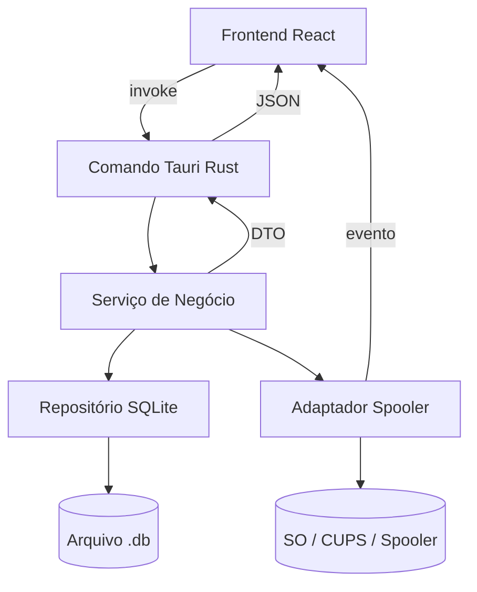

# Arquitetura do Sistema — Print 360

**Responsável:** Aquino Consultoria
**Status:** Planejamento
**Versão:** 1.0

---

## 1. Visão Arquitetural

O Print 360 segue a arquitetura nativa do **Tauri 2**: um shell desktop leve (Webview nativa) que hospeda o frontend web, communicating com um **backend Rust** por meio de um canal IPC seguro e tipado. O **SQLite** é embarcado no processo Rust, garantindo que todos os dados permaneçam no dispositivo do usuário.

```
┌──────────────────────────────────────────────────────────────┐
│                    FRONTEND (Webview)                        │
│  React + TypeScript + Vite  ·  Design System (CSS Tokens)    │
│  Páginas: Dashboard, Fila, Impressoras, Suprimentos, ...     │
└───────────────────────────┬──────────────────────────────────┘
                            │  IPC (invoke / events) — Tauri 2
┌───────────────────────────▼──────────────────────────────────┐
│                    BACKEND (Rust)                            │
│  ┌──────────────┐  ┌──────────────┐  ┌────────────────────┐  │
│  │ Comandos     │  │ Serviços     │  │ Integração SO      │  │
│  │ (IPC)        │→ │ (regras)     │→ │ (spooler/CUPS)     │  │
│  └──────────────┘  └──────┬───────┘  └────────────────────┘  │
│                           │                                  │
│  ┌────────────────────────▼───────────────────────────────┐  │
│  │ Camada de Repositório (rusqlite / SQLx)                │  │
│  └────────────────────────┬───────────────────────────────┘  │
└───────────────────────────┼──────────────────────────────────┘
                            │
┌───────────────────────────▼──────────────────────────────────┐
│               SQLite (arquivo local, modo WAL)              │
└──────────────────────────────────────────────────────────────┘
```

---

## 2. Camadas

### 2.1 Frontend (Webview)
- **React 18 + TypeScript** com Vite;
- Gerenciamento de estado com Zustand (leve) ou Context API;
- Consumo dos comandos Rust via `@tauri-apps/api/core` (`invoke`);
- Escuta de eventos via `@tauri-apps/api/event` para atualizações em tempo real;
- Navegação entre telas com roteamento leve (React Router ou estado local);
- Segue o Design System em `../design_system/design_system.md`.

### 2.2 Comandos IPC (Rust)
- Definidos com `#[tauri::command]`;
- Agrupados por domínio: `impressoras`, `fila`, `suprimentos`, `usuarios`, `relatorios`, `config`;
- Todo argumento é desserializado em structs tipadas e validado antes do uso;
- Retornam `Result<T, AppError>` para propagar erros ao frontend de forma controlada.

### 2.3 Serviços de Negócio (Rust)
- `servico_impressoras`, `servico_fila`, `servico_suprimentos`, `servico_custos`, `servico_alertas`;
- Contêm as regras de negócio (cálculo de custo, avaliação de cotas, geração de alertas);
- Independentes de Tauri e de banco — facilitam testes unitários.

### 2.4 Integração com o Sistema Operacional (Rust)
- **Windows:** Windows Print Spooler API (via crates FFI / `windows` crate);
- **Linux/macOS:** CUPS (via `ipp` / chamada a `lpstat`, `cancel`, `lp`);
- Abstração via trait `Spooler` com implementações por plataforma (`cfg(target_os)`);
- Execução de consultas em segundo plano com tokio.

### 2.5 Repositório de Dados
- **SQLite** via `rusqlite` (sincrono, simples) ou `sqlx` (assíncrono) — decisão a confirmar na implementação;
- Modo **WAL** para concorrência entre leitura e escrita;
- Migrations versionadas em `src-tauri/migrations/`;
- Pool de conexão gerenciado pelo estado do Tauri (`State<AppState>`).

---

## 3. Fluxo de Dados

### 3.1 Leitura (ex.: carregar dashboard)
1. Frontend chama `invoke("obter_resumo_dashboard")`;
2. Comando Rust valida argumentos e delega ao `servico_relatorios`;
3. Serviço consulta o repositório (SQLite) e/ou o spooler;
4. Dados são agregados em DTOs e retornados como JSON;
5. Frontend atualiza a interface.

### 3.2 Atualização em tempo real (ex.: novo trabalho na fila)
1. Coletor em segundo plano (Rust) consulta o spooler a cada 15 s;
2. Detecta mudança → emite evento Tauri `fila_atualizada`;
3. Frontend escuta o evento e recarrega apenas a lista afetada;
4. Persistência das mudanças é feita no SQLite via repositório.

---

## 4. Estado da Aplicação (`AppState`)

```rust
struct AppState {
    db: Database,              // conexão/pool SQLite
    spooler: Arc<dyn Spooler>, // integração com SO
    config: ConfigState,       // configuração carregada
    coletor: JoinHandle<()>,   // task de coleta em segundo plano
}
```

Injetado nos comandos via `State<'_, AppState>` do Tauri.

---

## 5. Segurança

- `tauri.conf.json` com `capabilities` restritas: apenas `core:default` e plugins necessários;
- Nenhuma permissão de filesystem ampla; acesso ao banco feito pelo Rust, não pelo frontend;
- Comandos validam entrada e aplicam limites (ex.: tamanho máximo de paginação);
- CSP (Content Security Policy) rígida no frontend;
- Logs não registram dados sensíveis de documentos.

---

## 6. Plugins Tauri 2 Previstos

| Plugin | Uso |
| --- | --- |
| `tauri-plugin-sql` (ou rusqlite direto) | Persistência |
| `tauri-plugin-notification` | Notificações do SO (RF-025) |
| `tauri-plugin-updater` | Atualizações (RNF-035) |
| `tauri-plugin-dialog` | Seleção de arquivos para backup/exportação |
| `tauri-plugin-store` | Preferências leves (tema, idioma) — opcional |

---

## 7. Decisões Técnicas (ADRs resumidas)

| ADR | Decisão | Justificativa |
| --- | --- | --- |
| ADR-001 | Tauri 2 em vez de Electron | Binário menor, memória menor, segurança nativa |
| ADR-002 | SQLite embarcado | Zero configuração de servidor, dados locais |
| ADR-003 | Rust para integração com spooler | Performance, segurança e FFI nativa |
| ADR-004 | React + TS no frontend | Ecossistema maduro, tipagem e produtividade |
| ADR-005 | Comandos por domínio | Organização e manutenibilidade do IPC |

---

## 8. Diagrama de Fluxo (Mermaid)



---

## 9. Implementação do M2 — Frota e Fila

A arquitetura foi materializada no M2 com os seguintes ajustes:

- `AppState` passa a conter `db: Arc<Mutex<Connection>>` e `spooler: Arc<dyn Spooler>`,
  gerenciado como `Arc<AppState>` pelo Tauri;
- **Adaptadores concretos:** `spooler_windows.rs` (cmdlets `PrintManagement` + `net pause/continue`)
  e `spooler_cups.rs` (`lpstat`, `lp`, `cancel`, `cupsenable`, `cupsdisable`), selecionados
  por `cfg(target_os)`. A escolha por cmdlets oficiais em vez de FFI reduziu o risco de
  quebra entre versões do Windows; o trait `Spooler` mantém a possibilidade de troca futura;
- **Coletor (`integracao/coletor.rs`):** task Tokio iniciada no `setup`, com intervalo de 15 s,
  sincronização transacional spooler → SQLite e emissão dos eventos `fila_atualizada`,
  `impressoras_atualizadas` e `alertas_atualizados`;
- **Migration 0002:** `id_sistema`, `origem`, índice único de nome de impressora e índice
  único completo de `id_sistema` (necessário para `ON CONFLICT` no UPSERT);
- **Trabalhos ausentes no spooler** são marcados como `concluido` (não excluídos),
  preservando o histórico (RF-010);
- **Alertas de erro** são criados automaticamente para impressoras em estado `erro`.

---

## 10. Implementação do M3 — Suprimentos, Usuários e Custos

- **Migration 0003:** coluna `colorida` na fila, índice único de cota por usuário,
  setores padrão e chaves de configuração de limites/alertas.
- **Serviços de domínio:** `servico_suprimentos` (níveis, previsão, trocas e alertas),
  `servico_custos` (parâmetros, custo por página e relatório agregado),
  `servico_usuarios` (cadastro, cotas e alertas de excesso) e `servico_alertas`.
- **Relatórios:** agregação em memória a partir de `fila_impressao`, com evolução mensal,
  rateio por setor e custo por impressora; exportação CSV com BOM UTF-8 e separador `;`.
- **Notificações:** o coletor usa `tauri-plugin-notification` para avisos críticos, com
  controle de duplicidade por id de alerta.
- **Frontend:** modais de troca/cota/usuário, gráficos Recharts alimentados pelo relatório
  real e central de alertas lateral aberta pelo sino da topbar.

---

## 11. Implementação do M4 — Configuração e Refino

- `AppState` passa a guardar `caminho_db`, permitindo backup e restauração.
- **Backup:** `VACUUM INTO` gera um snapshot íntegro sem parar a aplicação.
- **Restauração:** valida o arquivo (`schema_migrations`), libera a conexão atual no Windows,
  remove sidecars `-wal`/`-shm`, copia o arquivo, reabre e reaplica migrations.
- **Auditoria:** `servico_auditoria::registrar` é chamado pelos comandos de impressoras, fila,
  suprimentos, usuários, cotas, alertas e configurações; a tela exibe os últimos 100 registros.
- **Acessibilidade:** tokens de texto ajustados para contraste ≥ 4.5:1, skip link, `aria-live`
  no toast, `role="dialog"` e `Esc` nos modais, foco visível e `prefers-reduced-motion`.
  Lighthouse: acessibilidade 1.00 e boas práticas 1.00.
- **Code-splitting:** `React.lazy` + `Suspense` por tela; bundle inicial caiu de ~628 KB para ~175 KB.

---

*Aquino Consultoria — tecnologia com propósito.*
