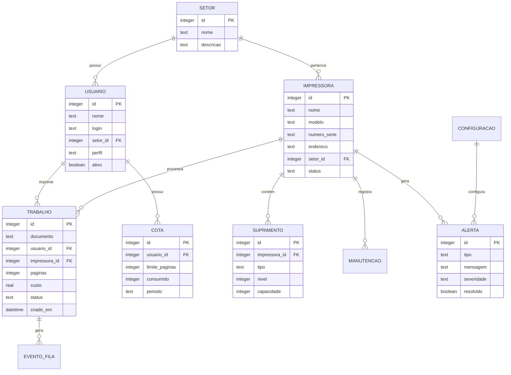

# Modelo de Dados — Print 360

**Responsável:** Aquino Consultoria
**Status:** Planejamento
**Versão:** 1.0
**SGBD:** SQLite (modo WAL, foreign keys ativadas)

---

## 1. Diagrama Entidade-Relacionamento (Mermaid)



---

## 2. DDL das Tabelas

### 2.1 `setores`
```sql
CREATE TABLE setores (
    id          INTEGER PRIMARY KEY AUTOINCREMENT,
    nome        TEXT NOT NULL UNIQUE,
    descricao   TEXT,
    criado_em   DATETIME NOT NULL DEFAULT CURRENT_TIMESTAMP
);
```

### 2.2 `usuarios`
```sql
CREATE TABLE usuarios (
    id          INTEGER PRIMARY KEY AUTOINCREMENT,
    nome        TEXT NOT NULL,
    login       TEXT NOT NULL UNIQUE,
    email       TEXT,
    setor_id    INTEGER REFERENCES setores(id) ON DELETE SET NULL,
    perfil      TEXT NOT NULL DEFAULT 'usuario'
                CHECK (perfil IN ('administrador','gestor','usuario')),
    ativo       INTEGER NOT NULL DEFAULT 1,
    criado_em   DATETIME NOT NULL DEFAULT CURRENT_TIMESTAMP
);
```

### 2.3 `impressoras`
```sql
CREATE TABLE impressoras (
    id              INTEGER PRIMARY KEY AUTOINCREMENT,
    nome            TEXT NOT NULL,
    modelo          TEXT,
    fabricante      TEXT,
    numero_serie    TEXT UNIQUE,
    endereco        TEXT,
    localizacao     TEXT,
    setor_id        INTEGER REFERENCES setores(id) ON DELETE SET NULL,
    status          TEXT NOT NULL DEFAULT 'desconhecido'
                    CHECK (status IN ('pronta','ocupada','erro','pausada',
                                      'offline','manutencao','desconhecido')),
    firmware        TEXT,
    ultima_vista     DATETIME,
    criado_em       DATETIME NOT NULL DEFAULT CURRENT_TIMESTAMP
);
```

### 2.4 `fila_impressao` (trabalhos ativos e histórico)
```sql
CREATE TABLE fila_impressao (
    id              INTEGER PRIMARY KEY AUTOINCREMENT,
    documento       TEXT NOT NULL,
    usuario_id      INTEGER REFERENCES usuarios(id) ON DELETE SET NULL,
    impressora_id   INTEGER NOT NULL REFERENCES impressoras(id),
    paginas         INTEGER NOT NULL DEFAULT 0,
    copias          INTEGER NOT NULL DEFAULT 1,
    tamanho_bytes   INTEGER,
    prioridade      INTEGER NOT NULL DEFAULT 5,
    status          TEXT NOT NULL
                    CHECK (status IN ('pendente','processando','pausado',
                                      'concluido','cancelado','erro')),
    progresso       INTEGER NOT NULL DEFAULT 0 CHECK (progresso BETWEEN 0 AND 100),
    custo_estimado  REAL NOT NULL DEFAULT 0,
    criado_em       DATETIME NOT NULL DEFAULT CURRENT_TIMESTAMP,
    iniciado_em     DATETIME,
    concluido_em    DATETIME
);
CREATE INDEX idx_fila_status ON fila_impressao(status);
CREATE INDEX idx_fila_impressora ON fila_impressao(impressora_id);
CREATE INDEX idx_fila_criado ON fila_impressao(criado_em);
```

### 2.5 `eventos_fila` (trilha por trabalho)
```sql
CREATE TABLE eventos_fila (
    id          INTEGER PRIMARY KEY AUTOINCREMENT,
    trabalho_id INTEGER NOT NULL REFERENCES fila_impressao(id) ON DELETE CASCADE,
    acao        TEXT NOT NULL,
    detalhe     TEXT,
    registro_em DATETIME NOT NULL DEFAULT CURRENT_TIMESTAMP
);
```

### 2.6 `suprimentos`
```sql
CREATE TABLE suprimentos (
    id              INTEGER PRIMARY KEY AUTOINCREMENT,
    impressora_id   INTEGER NOT NULL REFERENCES impressoras(id) ON DELETE CASCADE,
    tipo            TEXT NOT NULL
                    CHECK (tipo IN ('toner_preto','toner_ciano','toner_magenta',
                                    'toner_amarelo','tambor','papel','grampo')),
    nivel           INTEGER NOT NULL CHECK (nivel BETWEEN 0 AND 100),
    capacidade      INTEGER,
    ultima_troca    DATETIME,
    atualizado_em   DATETIME NOT NULL DEFAULT CURRENT_TIMESTAMP,
    UNIQUE(impressora_id, tipo)
);
```

### 2.7 `manutencoes`
```sql
CREATE TABLE manutencoes (
    id              INTEGER PRIMARY KEY AUTOINCREMENT,
    impressora_id   INTEGER NOT NULL REFERENCES impressoras(id) ON DELETE CASCADE,
    tipo            TEXT NOT NULL,
    descricao       TEXT,
    responsavel     TEXT,
    custo           REAL,
    realizada_em    DATETIME NOT NULL DEFAULT CURRENT_TIMESTAMP
);
```

### 2.8 `cotas`
```sql
CREATE TABLE cotas (
    id                INTEGER PRIMARY KEY AUTOINCREMENT,
    usuario_id        INTEGER REFERENCES usuarios(id) ON DELETE CASCADE,
    setor_id          INTEGER REFERENCES setores(id) ON DELETE CASCADE,
    limite_paginas    INTEGER NOT NULL,
    consumido         INTEGER NOT NULL DEFAULT 0,
    periodo           TEXT NOT NULL DEFAULT 'mensal',
    inicio_periodo    DATE NOT NULL,
    bloquear_excesso  INTEGER NOT NULL DEFAULT 0,
    CHECK (usuario_id IS NOT NULL OR setor_id IS NOT NULL)
);
```

### 2.9 `parametros_custo`
```sql
CREATE TABLE parametros_custo (
    id                  INTEGER PRIMARY KEY CHECK (id = 1),
    custo_pagina_preto  REAL NOT NULL DEFAULT 0.25,
    custo_pagina_cor    REAL NOT NULL DEFAULT 0.85,
    custo_toner         REAL NOT NULL DEFAULT 0.0,
    custo_papel         REAL NOT NULL DEFAULT 0.0,
    margem_manutencao   REAL NOT NULL DEFAULT 0.0,
    moeda               TEXT NOT NULL DEFAULT 'BRL',
    atualizado_em       DATETIME NOT NULL DEFAULT CURRENT_TIMESTAMP
);
```

### 2.10 `alertas`
```sql
CREATE TABLE alertas (
    id          INTEGER PRIMARY KEY AUTOINCREMENT,
    tipo        TEXT NOT NULL
                CHECK (tipo IN ('suprimento_baixo','erro_impressora',
                                'fila_travada','cota_excedida','manutencao')),
    severidade  TEXT NOT NULL DEFAULT 'aviso'
                CHECK (severidade IN ('info','aviso','critico')),
    titulo      TEXT NOT NULL,
    mensagem    TEXT,
    impressora_id INTEGER REFERENCES impressoras(id) ON DELETE SET NULL,
    resolvido   INTEGER NOT NULL DEFAULT 0,
    criado_em   DATETIME NOT NULL DEFAULT CURRENT_TIMESTAMP,
    resolvido_em DATETIME
);
CREATE INDEX idx_alertas_resolvido ON alertas(resolvido);
```

### 2.11 `configuracoes`
```sql
CREATE TABLE configuracoes (
    chave       TEXT PRIMARY KEY,
    valor       TEXT NOT NULL,
    descricao   TEXT
);
```

### 2.12 `auditoria`
```sql
CREATE TABLE auditoria (
    id          INTEGER PRIMARY KEY AUTOINCREMENT,
    usuario_id  INTEGER REFERENCES usuarios(id) ON DELETE SET NULL,
    acao        TEXT NOT NULL,
    entidade    TEXT NOT NULL,
    entidade_id INTEGER,
    detalhe     TEXT,
    registro_em DATETIME NOT NULL DEFAULT CURRENT_TIMESTAMP
);
```

### 2.13 `metricas_diarias` (agregações para relatórios)
```sql
CREATE TABLE metricas_diarias (
    id              INTEGER PRIMARY KEY AUTOINCREMENT,
    data            DATE NOT NULL,
    impressora_id   INTEGER REFERENCES impressoras(id) ON DELETE CASCADE,
    setor_id        INTEGER REFERENCES setores(id) ON DELETE CASCADE,
    paginas_preto   INTEGER NOT NULL DEFAULT 0,
    paginas_cor     INTEGER NOT NULL DEFAULT 0,
    custo_total     REAL NOT NULL DEFAULT 0,
    UNIQUE(data, impressora_id, setor_id)
);
```

---

## 3. Migrations

As migrations serão versionadas em `src-tauri/migrations/` com o padrão:

```
0001_inicial.sql
0002_metricas_diarias.sql
...
```

Uma tabela `schema_migrations` controlará quais já foram aplicadas. O sistema aplica pendentes na inicialização, dentro de uma transação.

---

## 4. Regras de Integridade

- `foreign_keys = ON` em toda conexão;
- `journal_mode = WAL` e `synchronous = NORMAL`;
- Escritas críticas (ex.: baixa de cota + registro de trabalho) em transação única;
- Nunca excluir impressora com trabalhos em andamento — usar desativação lógica.

---

*Aquino Consultoria — tecnologia com propósito.*
