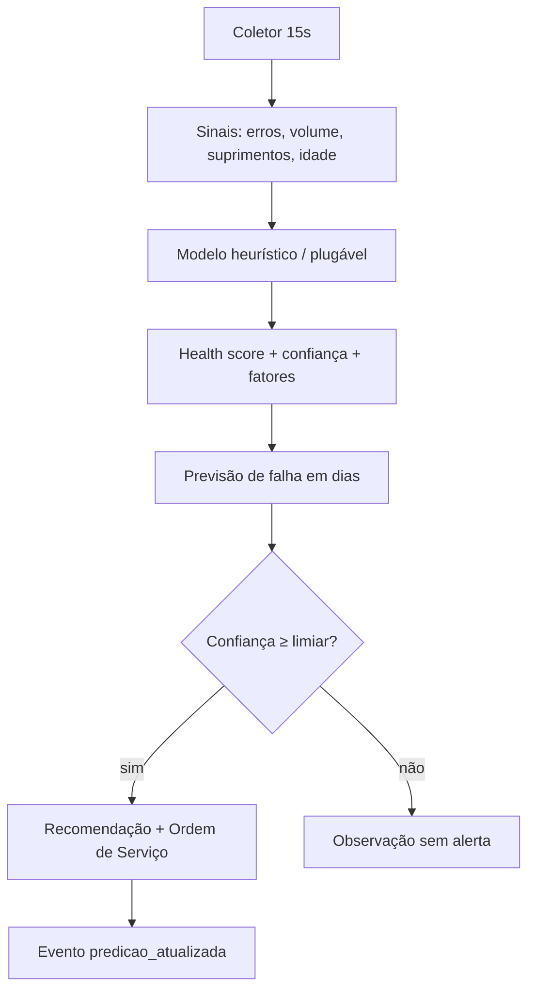
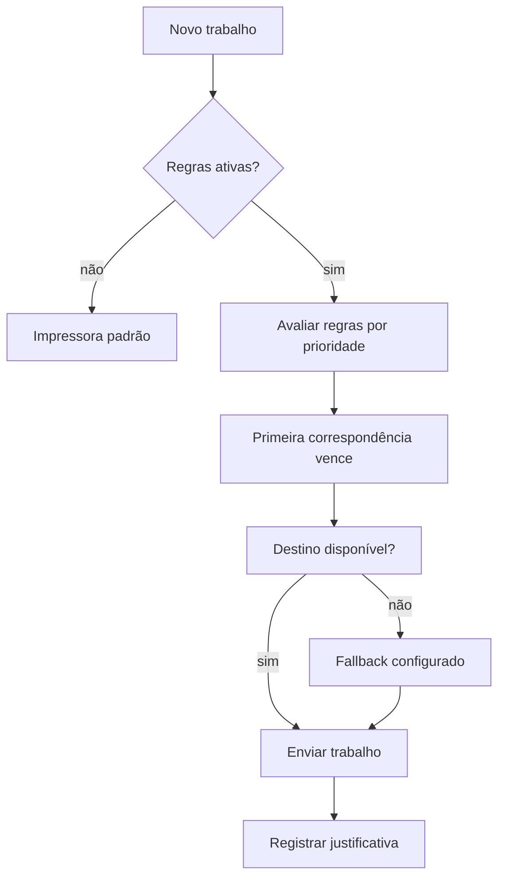
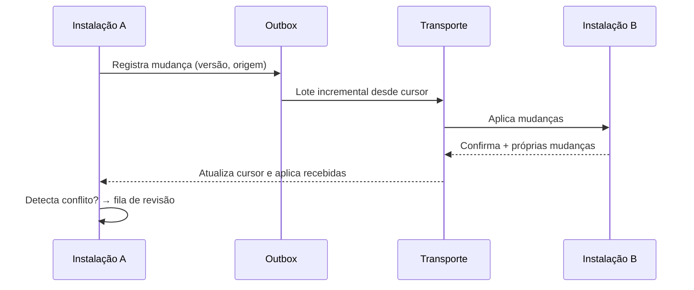

# Arquitetura — Recursos Avançados (Print 360)

**Responsável:** Aquino Consultoria
**Versão:** 1.0 — para aprovação

---

## 1. Visão Arquitetural

Os recursos avançados adicionam três módulos de domínio ao backend Rust, mantendo o frontend desacoplado
via comandos Tauri. Nenhuma dependência de servidor é obrigatória.

```
┌─────────────────────────────────────────────────────────────────────────┐
│                         FRONTEND (React)                               │
│  08 Manutenção Preditiva · 09 Saúde · 10 Roteamento · 11 Sync · 12 Config│
└──────────────────────────────┬──────────────────────────────────────────┘
                               │ IPC (invoke + eventos)
┌──────────────────────────────▼──────────────────────────────────────────┐
│                        BACKEND (Rust / Tauri 2)                        │
│  ┌───────────────┐  ┌────────────────┐  ┌───────────────────────────┐  │
│  │ predicao/     │  │ roteamento/    │  │ sincronizacao/            │  │
│  │ health score  │  │ motor de regras│  │ outbox + transporte       │  │
│  │ previsão      │  │ simulador      │  │ resolução de conflitos    │  │
│  └───────┬───────┘  └───────┬────────┘  └────────────┬──────────────┘  │
│          │                  │                        │                 │
│          └──────────┬───────┴────────────────────────┘                 │
│                     ▼                                                  │
│          Repositório SQLite (migrations 0004+)                         │
└──────────────────────────────┬──────────────────────────────────────────┘
                               │
                   Transporte opcional (arquivo / LAN / nuvem)
```

---

## 2. Módulos novos

### 2.1 `predicao/`
- `health.rs` — cálculo do health score com pesos configuráveis;
- `previsao.rs` — estimativa de dias para falha/esgotamento;
- `sinais.rs` — coleta de sinais (erros, volume, suprimentos, idade, manutenção);
- `modelo.rs` — trait `ModeloPreditivo` com implementação heurística padrão (`ModeloHeuristico`).

### 2.2 `roteamento/`
- `regra.rs` — estrutura Condição → Ação;
- `motor.rs` — avaliação ordenada por prioridade, primeira correspondência vence;
- `simulador.rs` — execução sem efeito colateral;
- `justificativa.rs` — registro do motivo da decisão.

### 2.3 `sincronizacao/`
- `outbox.rs` — fila de mudanças com versão lógica e origem;
- `transporte.rs` — trait `Transporte` (implementações: `Arquivo`, `Http`, `RedeLocal`);
- `conflito.rs` — detecção e políticas de resolução;
- `cursor.rs` — controle do último cambio processado por par de instalações.

---

## 3. Fluxos principais

### 3.1 Predição (Mermaid)


### 3.2 Roteamento (Mermaid)


### 3.3 Sincronização (Mermaid)


---

## 4. Novos comandos IPC (planejados)

| Comando | Módulo | Finalidade |
| --- | --- | --- |
| `obter_saude_frota` | predicao | Health score de todas as impressoras |
| `obter_previsoes` | predicao | Previsões com fatores e confiança |
| `criar_ordem_servico` | predicao | Gerar OS a partir de recomendação |
| `listar_regras` / `salvar_regra` | roteamento | Gestão de regras |
| `simular_roteamento` | roteamento | Dry-run de uma regra |
| `listar_instalacoes` / `sincronizar_agora` | sincronizacao | Topologia e disparo manual |
| `listar_conflitos` / `resolver_conflito` | sincronizacao | Revisão de conflitos |
| `obter_config_avancado` / `salvar_config_avancado` | config | Feature flags e parâmetros |

---

## 5. Novos eventos Tauri

| Evento | Quando |
| --- | --- |
| `predicao_atualizada` | Novo health score ou previsão |
| `roteamento_decidido` | Trabalho roteado automaticamente |
| `sync_iniciada` / `sync_concluida` | Ciclos de sincronização |
| `conflito_detectado` | Alteração concorrente |

---

## 6. Decisões Técnicas (ADRs dos recursos avançados)

| ADR | Decisão | Justificativa |
| --- | --- | --- |
| F2-001 | Heurística ponderada como baseline | Funciona offline, transparente e sem dependência de runtime de ML |
| F2-002 | Trait `ModeloPreditivo` plugável | Permite trocar por modelo treinado sem alterar UI ou schema |
| F2-003 | Outbox + versionamento lógico por entidade | Idempotência e sincronização incremental sem exigir relógios sincronizados |
| F2-004 | Transporte abstrato (arquivo/LAN/nuvem) | Respeita a soberania dos dados; nuvem é opcional |
| F2-005 | First-match vence em regras | Previsibilidade e explicabilidade |
| F2-006 | Simulação obrigatória antes de ativar regra | Evita surpresas em produção |
| F2-007 | Feature flags por módulo | Adoção incremental e rollback imediato |

---

## 7. Impacto na v1.0

- Nenhuma tabela existente é removida; migrations aditivas (0004+);
- Comandos v1.0 permanecem intactos;
- O coletor existente passa a alimentar também `predicao/` e `outbox`;
- A flag `CREATE_NO_WINDOW` (correção do M4) é preservada em todos os processos externos.

---

## 8. Implementação do M1

- **Migration 0004** aditiva: `saude_dispositivo`, `previsoes_falha`, `ordens_servico`
  e chaves de configuração `f2_predicao_ativa`, `f2_horizonte_dias`, `f2_confianca_minima`.
- `AppState.modelo: Arc<dyn ModeloPreditivo>` permite trocar a heurística sem alterar comandos.
- `predicao/sinais.rs` coleta 7 sinais e conta as fontes disponíveis para calibrar confiança.
- `ModeloHeuristico` gera health score (7 fatores com peso explícito) e previsões para 4 componentes.
- `predicao/servico.rs` persiste em transação e substitui apenas previsões não resolvidas.
- O coletor recalcula apenas quando `f2_predicao_ativa = true`; falhas de predição nunca
  interrompem a coleta principal.
- Comandos novos e telas 08/09 com `HealthGauge` acessível (`role="img"` + valor textual).

---

## 9. Implementação do M2

- **Migration 0005** aditiva: `regras_roteamento`, `execucoes_roteamento` e parâmetros de flag,
  critério padrão e tentativas de fallback.
- `roteamento/regra.rs` define `Condicao`, `Acao`, `Contexto`, `Candidato` e `Decisao`.
- `roteamento/motor.rs` implementa first-match por prioridade, 5 operadores e 4 critérios;
  sempre produz justificativa e respeita fallback.
- `roteamento/servico.rs` persiste regras com JSON validado, simula sem efeito colateral e
  registra decisões para novos trabalhos quando `f2_roteamento_ativo = true`.
- A aplicação da decisão no spooler (envio efetivo) fica para evolução do adaptador;
  o registro em `execucoes_roteamento` garante auditoria desde já.
- Tela 10 com travamento do botão "Salvar e ativar" até uma simulação bem-sucedida (RF2-017).

---

## 10. Implementação do M3

- **Migration 0006** aditiva: `instalacoes`, `versoes_entidade`, `outbox`, `sincronizacoes`
  e `conflitos_sincronizacao`, além das chaves de configuração.
- `AppState.transporte: Arc<dyn Transporte>` é escolhido no boot a partir de `f2_sync_transporte`.
- `TransporteArquivo` grava JSONL e é idempotente; `TransporteHttp` usa `ureq` com TLS e token Bearer.
- Controle de versão por `(entidade, entidade_id)` com `versoes_entidade`: versões já aplicadas
  são ignoradas; origens divergentes geram conflito deduplicado por versão remota.
- Política `manual` cria o conflito para revisão; `recente` aplica a remota; `origem` usa
  precedência lexicográfica do identificador.
- Sincronização automática opcional no coletor, com emissão de eventos; falha de transporte
  nunca interrompe a coleta do spooler.
- Tela 11 com topologia, outbox, ciclos e resolução de conflitos.

---

## 11. Implementação do M4 e entrega v2.0.0

- Nenhuma migration adicional: as chaves de configuração já foram introduzidas pelas migrations 0004, 0005 e 0006.
- Tela 12 com feature flags (`f2_predicao_ativa`, `f2_roteamento_ativo`, `f2_sync_ativa`)
  e parâmetros de cada módulo, agrupados por domínio.
- Alterações de configuração passam pelo comando de salvamento existente e são auditadas.
- Versão final 2.0.0 em `package.json`, `Cargo.toml` e `tauri.conf.json`.
- Instalador NSIS `Print 360_2.0.0_x64-setup.exe` gerado com makensis, em português (PortugueseBR).
- Validação final: `cargo test` 22/22, `npm run build` sem avisos e Lighthouse 1.00 nas novas telas.

## 12. Eliminação de dados fixos

- Novos comandos `obter_atividade_recente` e `listar_outbox` substituíram listas estáticas
  montadas no frontend; o feed de atividade é derivado de `fila_impressao`, `alertas` e `ordens_servico`.
- KPIs da fila, do roteamento e da manutenção passaram a ser calculados a partir das listas reais;
  filtros de impressora usam `listar_impressoras`; níveis usam `listar_suprimentos`.
- O texto de fallback do roteamento vem das regras e da configuração persistida.
- Dados de demonstração foram neutralizados (nomes genéricos e IPs de documentação), sem
  informações de impressoras reais fixadas no código.

---

*Aquino Consultoria — tecnologia com propósito.*
