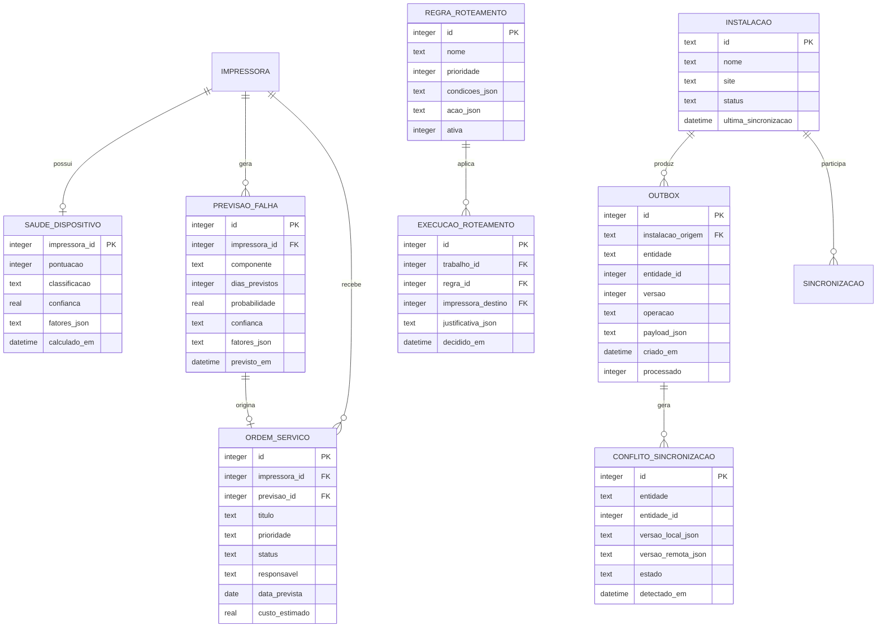

# Modelo de Dados — Recursos Avançados (Print 360)

**Responsável:** Aquino Consultoria
**Versão:** 1.0 — para aprovação
**Migrations:** 0004 a 0007 (aditivas sobre a v1.0)

---

## 1. Diagrama ER (Mermaid)



---

## 2. DDL (migrations 0004–0007)

### 2.1 `0004_predicao.sql`
```sql
CREATE TABLE saude_dispositivo (
    impressora_id INTEGER PRIMARY KEY REFERENCES impressoras(id) ON DELETE CASCADE,
    pontuacao     INTEGER NOT NULL CHECK (pontuacao BETWEEN 0 AND 100),
    classificacao TEXT NOT NULL CHECK (classificacao IN ('excelente','bom','atencao','critico')),
    confianca     REAL NOT NULL DEFAULT 0 CHECK (confianca BETWEEN 0 AND 1),
    fatores_json  TEXT NOT NULL DEFAULT '[]',
    calculado_em  DATETIME NOT NULL DEFAULT CURRENT_TIMESTAMP
);

CREATE TABLE previsoes_falha (
    id             INTEGER PRIMARY KEY AUTOINCREMENT,
    impressora_id  INTEGER NOT NULL REFERENCES impressoras(id) ON DELETE CASCADE,
    componente     TEXT NOT NULL,
    dias_previstos INTEGER NOT NULL,
    probabilidade  REAL NOT NULL CHECK (probabilidade BETWEEN 0 AND 1),
    confianca      TEXT NOT NULL CHECK (confianca IN ('baixa','media','alta')),
    fatores_json   TEXT NOT NULL DEFAULT '[]',
    resolvida      INTEGER NOT NULL DEFAULT 0,
    previsto_em    DATETIME NOT NULL DEFAULT CURRENT_TIMESTAMP
);
CREATE INDEX idx_previsoes_impressora ON previsoes_falha(impressora_id, resolvida);

CREATE TABLE ordens_servico (
    id              INTEGER PRIMARY KEY AUTOINCREMENT,
    impressora_id   INTEGER NOT NULL REFERENCES impressoras(id) ON DELETE CASCADE,
    previsao_id     INTEGER REFERENCES previsoes_falha(id) ON DELETE SET NULL,
    titulo          TEXT NOT NULL,
    prioridade      TEXT NOT NULL CHECK (prioridade IN ('baixa','media','alta','critica')),
    status          TEXT NOT NULL DEFAULT 'planejada'
                    CHECK (status IN ('planejada','agendada','em_execucao','concluida','cancelada')),
    responsavel     TEXT,
    data_prevista   DATE,
    custo_estimado  REAL,
    criada_em       DATETIME NOT NULL DEFAULT CURRENT_TIMESTAMP,
    concluida_em    DATETIME
);
```

### 2.2 `0005_roteamento.sql`
```sql
CREATE TABLE regras_roteamento (
    id            INTEGER PRIMARY KEY AUTOINCREMENT,
    nome          TEXT NOT NULL,
    prioridade    INTEGER NOT NULL DEFAULT 100,
    condicoes_json TEXT NOT NULL DEFAULT '[]',
    acao_json     TEXT NOT NULL DEFAULT '{}',
    ativa         INTEGER NOT NULL DEFAULT 1,
    criada_em     DATETIME NOT NULL DEFAULT CURRENT_TIMESTAMP
);

CREATE TABLE execucoes_roteamento (
    id                INTEGER PRIMARY KEY AUTOINCREMENT,
    trabalho_id       INTEGER NOT NULL REFERENCES fila_impressao(id) ON DELETE CASCADE,
    regra_id          INTEGER REFERENCES regras_roteamento(id) ON DELETE SET NULL,
    impressora_destino INTEGER NOT NULL REFERENCES impressoras(id),
    justificativa_json TEXT NOT NULL DEFAULT '{}',
    decidido_em       DATETIME NOT NULL DEFAULT CURRENT_TIMESTAMP
);
CREATE INDEX idx_execucoes_trabalho ON execucoes_roteamento(trabalho_id);
```

### 2.3 `0006_sincronizacao.sql`
```sql
CREATE TABLE instalacoes (
    id                    TEXT PRIMARY KEY,
    nome                  TEXT NOT NULL,
    site                  TEXT,
    status                TEXT NOT NULL DEFAULT 'ativo'
                          CHECK (status IN ('ativo','inativo')),
    ultima_sincronizacao  DATETIME,
    token_hash            TEXT,
    criada_em             DATETIME NOT NULL DEFAULT CURRENT_TIMESTAMP
);

CREATE TABLE outbox (
    id               INTEGER PRIMARY KEY AUTOINCREMENT,
    instalacao_origem TEXT NOT NULL REFERENCES instalacoes(id),
    entidade         TEXT NOT NULL,
    entidade_id      INTEGER NOT NULL,
    versao           INTEGER NOT NULL,
    operacao         TEXT NOT NULL CHECK (operacao IN ('insert','update','delete')),
    payload_json     TEXT NOT NULL,
    processado       INTEGER NOT NULL DEFAULT 0,
    criado_em        DATETIME NOT NULL DEFAULT CURRENT_TIMESTAMP,
    UNIQUE(instalacao_origem, entidade, entidade_id, versao)
);
CREATE INDEX idx_outbox_pendente ON outbox(processado, criado_em);

CREATE TABLE sincronizacoes (
    id             INTEGER PRIMARY KEY AUTOINCREMENT,
    instalacao_id  TEXT NOT NULL REFERENCES instalacoes(id),
    direcao        TEXT NOT NULL CHECK (direcao IN ('envio','recebimento')),
    itens          INTEGER NOT NULL DEFAULT 0,
    duracao_ms     INTEGER NOT NULL DEFAULT 0,
    status         TEXT NOT NULL CHECK (status IN ('sucesso','erro','parcial')),
    detalhe        TEXT,
    realizada_em   DATETIME NOT NULL DEFAULT CURRENT_TIMESTAMP
);

CREATE TABLE conflitos_sincronizacao (
    id                 INTEGER PRIMARY KEY AUTOINCREMENT,
    entidade           TEXT NOT NULL,
    entidade_id        INTEGER NOT NULL,
    versao_local_json  TEXT NOT NULL,
    versao_remota_json TEXT NOT NULL,
    estado             TEXT NOT NULL DEFAULT 'pendente'
                       CHECK (estado IN ('pendente','resolvido_local','resolvido_remoto')),
    detectado_em       DATETIME NOT NULL DEFAULT CURRENT_TIMESTAMP
);
```

### 2.4 `0007_config_avancado.sql`
```sql
INSERT OR IGNORE INTO configuracoes (chave, valor, descricao) VALUES
  ('f2_predicao_ativa', 'false', 'Habilita manutenção preditiva'),
  ('f2_roteamento_ativo', 'false', 'Habilita roteamento automático'),
  ('f2_sync_ativa', 'false', 'Habilita sincronização entre instalações'),
  ('f2_horizonte_dias', '30', 'Horizonte padrão das previsões'),
  ('f2_confianca_minima', '0.7', 'Confiança mínima para gerar recomendação'),
  ('f2_sync_intervalo_min', '15', 'Intervalo entre sincronizações'),
  ('f2_sync_conflito_policy', 'manual', 'Política: manual | recente | origem');
```

---

## 3. Regras de integridade

- `versao` do outbox é monotônica por `(instalacao_origem, entidade, entidade_id)`;
- Aplicar um lote já processado é no-op (UNIQUE + `processado`);
- Nenhuma tabela da v1.0 é alterada destrutivamente;
- `payload_json` nunca contém conteúdo de documento (RNF2-007).

---

*Aquino Consultoria — tecnologia com propósito.*
